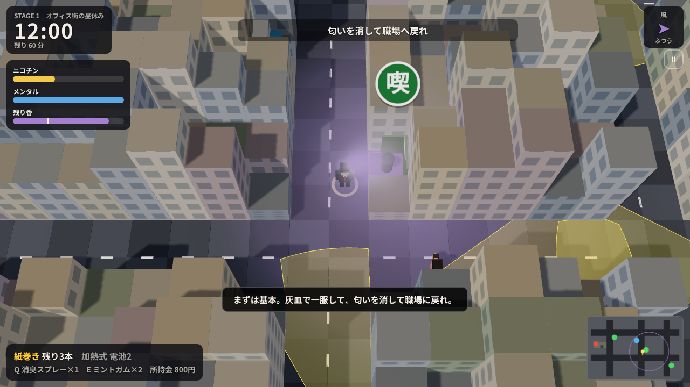

# SMOKE REFUGEE ～失われし灰皿（オアシス）を求めて～

**たった一服のために、ここまでやる。**

昼休みに喫煙所を探して一服し、匂いを消して、何事もなかった顔で職場に戻る。
愛煙家の必死さを笑う、ブラウザで遊べる3Dステルスコメディです。



> このゲームは喫煙を勧めるものではありません。成人向けのコメディ作品です。
> 登場する地名・団体・銘柄はすべて架空です。

## 遊ぶ

GitHub Pages で公開すると、次のURLでそのまま遊べます（リポジトリ名が `smoke-refugee` の場合）。

```
https://<GitHubのユーザー名>.github.io/smoke-refugee/
```

インストールは不要です。PCのブラウザ（Chrome / Edge / Safari / Firefox）推奨。スマホはタッチ操作に対応しています。

## 遊び方

1ステージは「**行きはニコチンとの戦い、帰りは匂いとの戦い**」です。

1. **行き**：ニコチンが切れる前に喫煙所を探す
2. **一服**：喫煙所で `Space`。吸った直後から匂いの輪が大きく広がる
3. **帰り**：匂いの輪に人を入れないように、時間内に職場へ戻る。入口で匂いチェックがある

| 操作 | キー |
| --- | --- |
| 移動 | `WASD` / 矢印キー |
| 走る（ニコチン消費1.5倍） | `Shift` |
| 一服する・店を使う（路上では2回押しで強行） | `Space` |
| 紙巻き ⇄ 加熱式 | `Tab` |
| 消臭スプレー | `Q` |
| ミントガム（メンタル回復） | `E` |
| 即リトライ | `R` |
| ポーズ / ミュート | `Esc` / `M` |

### ルール

- **ニコチン**：時間で減る。ゼロになると鈍足・手ブレ・イライラでメンタルが削れる
- **メンタル**：匂いに気づいた人に見られると舌打ちされて減る。ゼロでアウト
- **匂いの輪（紫）**：風下に流れる。輪に入った人は匂いの元を探して振り向く
- **視線（黄色の扇形）**：赤くなるほど疑われている
- **紙巻き**は回復大・匂い大、**加熱式**は匂い小だが加熱待ちとときどきエラー
- 地図の「喫」マークは情報が古い。**撤去済み**や**全面禁煙**のこともある
- 店：加熱式専用店（加）、喫茶店（茶・500円・屋内で安全）、コンビニ（コ・手洗い＋スプレー購入）
- 喫煙所の外で吸っているところを**路上喫煙指導員**に見られたら即アウト

### 失敗の例（死因）

「通りすがりの舌打ち」「風下に子ども連れ」「路上喫煙で指導」「上司『…タバコ吸ってきた？』」など。
失敗した瞬間に死因が大きく出て、`R` ひとつで即リトライできます。

## ステージ

| # | ステージ | 新しい要素 |
| --- | --- | --- |
| 1 | オフィス街の昼休み | 基本操作、撤去済み灰皿、上司の匂いチェック |
| 2 | 駅前ロータリー | 路上喫煙指導員、満員の喫煙所、風向きの変化 |
| 3 | 雨の商店街 | 雨で紙巻きに火がつかない、匂いに敏感な人、喫茶店で上司に遭遇 |
| 4 | 新幹線の乗り換え | 25分の乗り換え時間、喫煙ルームのどちらかが閉鎖 |
| 5 | 親戚の結婚式 | 親戚の視線、母の厳しい匂いチェック |

クリアするとランク（S〜C）と「本日の一服」の結果が出ます。結果画像の保存とXへのシェアができます。
自己ベストの動きは保存され、次のプレイでは半透明の**ゴースト**として一緒に走ります。

URLの末尾に `?all=1` を付けると全ステージが解放されます（配信の準備や確認用）。

## GitHub Pages で公開する

ビルドは不要です。リポジトリの中身をそのまま公開できます。

1. このフォルダの中身をGitHubのリポジトリ（例：`smoke-refugee`）にpushする
2. リポジトリの **Settings → Pages** を開く
3. **Build and deployment** の Source を **Deploy from a branch**、Branch を `main` / `/ (root)` にして Save
4. 1〜2分後に `https://<ユーザー名>.github.io/smoke-refugee/` で遊べる

## 手元で動かす

ESモジュールを使っているため、HTMLファイルを直接開くのではなく、簡易サーバー経由で開いてください。

```bash
cd smoke-refugee
python3 -m http.server 8000
# ブラウザで http://localhost:8000 を開く
```

## ステージを作る・直す

ステージは `src/stages.js` に文字のマップとして入っています。マップは1文字が1マスです。

| 文字 | 意味 |
| --- | --- |
| `#` | 建物 |
| `.` | 道路 |
| `,` | 歩道・広場 |
| `g` | 芝生 |
| `T` | 木・柱（通れない・視線をさえぎる） |
| `O` | 職場（スタート兼ゴール） |
| `P` / `G` | スタート / ゴール（別々のとき） |
| `S` | 喫煙所 |
| `X` | 撤去済み灰皿（地図には載っている） |
| `H` / `K` / `C` | 加熱式専用店 / 喫茶店 / コンビニ |

NPCは `type`（`walker` 通行人、`parent` 子連れ、`sensitive` 匂いに敏感な人、`guide` 路上喫煙指導員、`relative` 親戚、`ally` 愛煙家）と巡回ルート（マスの座標）で決まります。

`tools/genmaps.py` で、喫煙所に到達できるか、NPCのルートが壁を通っていないかを検証してから `src/stages.js` を書き出せます。

```bash
python3 tools/genmaps.py   # 最後に OK と出れば問題なし
```

## ファイル構成

```
index.html          画面の骨組み（タイトル、HUD、結果画面など）
css/style.css       見た目
src/main.js         起動、画面の切り替え、入力、セーブ、シェア
src/game.js         3Dの街、プレイヤー、NPC、匂い、ルール
src/ui.js           HUD、吹き出し、ミニマップ
src/audio.js        効果音とBGM（Web Audioで合成、音声ファイルなし）
src/textures.js     看板やマーカーの画像（Canvasで生成）
src/stages.js       5ステージのデータ
tools/genmaps.py    ステージの検証と書き出し
vendor/             three.js（r170）
```

3Dは [three.js](https://threejs.org/) を使っています。画像・音声の素材ファイルは使っていません（すべてコードで生成）。

## 配信・実況について

実況・配信・切り抜き動画は自由です。収益化もしてかまいません。
ゲーム内容は成人向けのコメディなので、配信サイトの年齢設定に合わせてご利用ください。

## ライセンス

コードは [MIT License](LICENSE) です。
同梱の three.js は MIT License（`vendor/three-LICENSE`）です。
